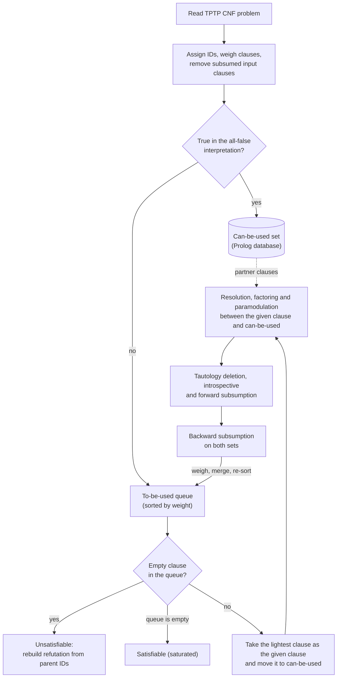

# Prolog Theorem Prover

A saturation-based theorem prover for first-order logic, written in SWI-Prolog for the Automated Reasoning course at the University of Miami. It reads problems in [TPTP](https://www.tptp.org) CNF format, searches for a refutation with a given-clause (ANL) loop, and reports the outcome as an SZS status, followed by the full refutation whenever it finds a proof.

On the course's held-out evaluation set, this prover solved the highest percentage of problems of any submission in the class.

## What it implements

- **Inference rules:** binary resolution, factoring, and oriented paramodulation for equality.
- **Search:** a lightest-first given-clause loop, where a clause's weight counts 2 for every symbol and 1 for every variable.
- **Term ordering:** a Knuth–Bendix-style ordering that restricts which literals can be resolved on and decides which direction an equation is used for rewriting.
- **Semantic guidance:** input clauses that are true in the all-false interpretation (any clause with a negative literal) go straight into the usable set, so the search starts only from the all-positive clauses.
- **Redundancy elimination:** tautology deletion, plus forward, backward and introspective θ-subsumption across both the to-be-used queue and the usable set.
- **Proof output:** every clause records its own ID and its parents' IDs, so once the empty clause appears the refutation is rebuilt by walking back through its ancestors.

## How the loop works



Each iteration takes the lightest clause from the to-be-used queue, moves it into the can-be-used set (stored as `cnf/3` facts in the Prolog database), and performs every inference between it and the can-be-used clauses. The new clauses are filtered for redundancy, weighed, merged back into the queue, and re-sorted. The loop stops when the empty clause appears (Unsatisfiable), when the queue runs dry because the clause set is saturated (Satisfiable), or when the time limit expires (Timeout).

### Clause representation

Clauses are stored as `cnf([ID, Origin, Parent1, Parent2], Literals, Weight)`. Input clauses keep their TPTP name as the origin and have `none` for both parents, while derived clauses are tagged `resolvant`, `factor` or `paramodulated` along with the IDs of the clauses they came from. When backward subsumption removes a clause from the usable set, it is moved to `cnf_old/3` rather than deleted, so it can still appear in a proof.

### Ordering

`kbo_bigger/2` treats a term s as larger than t when every variable in t occurs in s at least as many times and s has the larger weight, with ties broken by Prolog's standard order of terms. The ordering is used in three places:

- when the given clause has no negative literals, only its maximal literal can be resolved on;
- factoring only merges a literal that nothing else in the clause is larger than;
- paramodulation always rewrites the larger side of an equation into the smaller side.

### Equality

Paramodulation takes a positive equation from the given clause and rewrites its larger side wherever that term occurs inside a non-equality literal of a usable clause. Since this isn't a complete equality calculus on its own, the problem set also includes `+Eq` variants that state the equality axioms (reflexivity, symmetry, transitivity and substitution) explicitly. TPTP's `!=` is converted into a negated equation when the problem is read.

## Running it

Install [SWI-Prolog](https://www.swi-prolog.org) (tested with 9.0.4), load the prover, and call `prove/2` with a problem file and a time limit in seconds:

```bash
swipl thm_prover.pl
```

```prolog
?- prove('ANLLoopProblems/SYN068-1.p', 60).
```

To run every bundled problem and print only the status lines:

```bash
for f in ANLLoopProblems/*.p; do
  swipl -q -g "consult('thm_prover.pl'), prove('$f', 60)" -t halt 2>/dev/null | grep 'SZS status'
done
```

A bare problem name such as `'PUZ001-1'` is resolved against a local copy of the TPTP library, whose location is set by `tptp_directory/1` near the top of `thm_prover.pl` (the default is `/home/tptp/TPTP`). The same path is used for `include('Axioms/...')` directives.

### Example output

This is the proof of Pelletier's problem 44 (`SYN068-1`), with variable names shortened:

```
% SZS status Unsatisfiable for ANLLoopProblems/SYN068-1.p : CPU = 0.0005; Loops = 7
% SZS output start Refutation for ANLLoopProblems/SYN068-1.p
cnf_old([3,clause_3,none,none],[~big_f(X),big_g(g(X))],8)
cnf_old([4,clause_4,none,none],[~big_f(X),~big_h(X,g(X))],9)
cnf_old([5,clause_5,none,none],[big_j(a)],4)
cnf_old([6,clause_6,none,none],[~big_g(X),big_h(a,X)],8)
cnf_old([7,clause_7,none,none],[~big_j(X),big_f(X)],6)
cnf_old([8,resolvant,5,7],[big_f(a)],4)
cnf_old([10,resolvant,8,3],[big_g(g(a))],6)
cnf_old([12,resolvant,8,4],[~big_h(a,g(a))],8)
cnf_old([15,resolvant,12,6],[~big_g(g(a))],6)
cnf([17,resolvant,15,10],[],weight)
% SZS output end Refutation for ANLLoopProblems/SYN068-1.p
```

Reading from the bottom, the empty clause 17 was derived by resolving clauses 15 and 10, and each of those traces back the same way to the input clauses. `Loops` is the number of given clauses the loop processed. Clauses printed as `cnf_old` were moved out of the usable set by backward subsumption, which happens to every clause once the empty clause has been derived.
